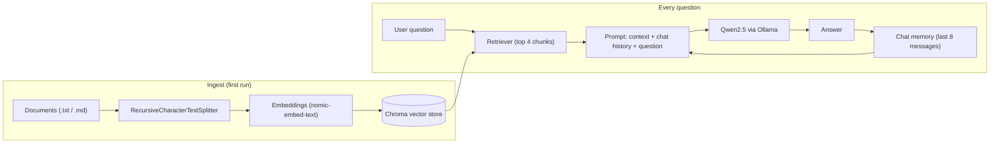
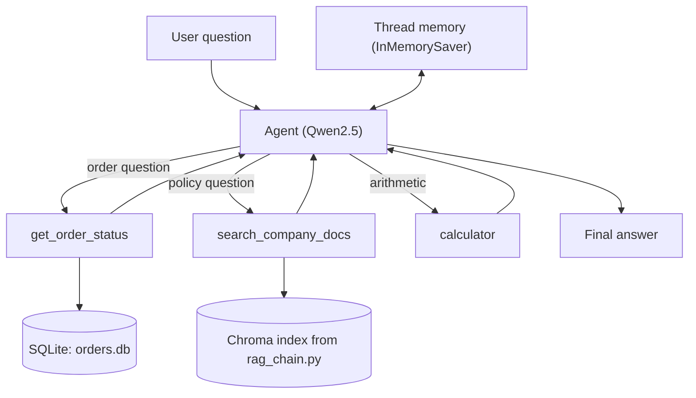

# Qwen2.5 RAG + Agent (LangChain, local)

A fully local assistant built with **LangChain** and **Qwen2.5** running on **Ollama**. No API keys and no data leaves your machine.

It contains two modules:

| Module | What it does |
|---|---|
| `rag_chain.py` | Answers questions from your own documents (RAG) with multi-turn chat memory |
| `agent_orchestrator.py` | A tool-calling agent that decides between a database lookup, document search and a calculator |

## Architecture

### RAG pipeline (`rag_chain.py`)



### Agent (`agent_orchestrator.py`)



## Requirements

- Python 3.10+
- [Ollama](https://ollama.com/download) installed and running
- About 6 GB of free disk space for the models

## Setup

```bash
# 1. Pull the models
ollama pull qwen2.5
ollama pull nomic-embed-text

# 2. Create and activate a virtual environment
python -m venv venv
venv\Scripts\activate          # Windows
# source venv/bin/activate     # Mac/Linux

# 3. Install dependencies
pip install -U langchain langchain-core langchain-community langchain-ollama \
    langchain-chroma langchain-text-splitters langgraph
```

Put your `.txt` and `.md` files in `./docs`. Sample files are included.

## Usage

**RAG chat over your documents**

```bash
python rag_chain.py --docs ./docs            # first run builds the index
python rag_chain.py --docs ./docs --rebuild  # re-index after changing documents
```

**Tool-calling agent**

```bash
python agent_orchestrator.py --docs ./docs
```

Example questions:

- `What is the refund policy?` calls `search_company_docs`
- `What's the status of order A100?` calls `get_order_status`
- `What is 2499 * 3 + 50?` calls `calculator`
- `Status of order A101, and how long is the warranty?` calls two tools in one turn

The agent prints a `[tool]` line each time it calls a tool.

## Project structure

```
qwen-rag/
├── rag_chain.py            # RAG pipeline + chat memory
├── agent_orchestrator.py   # Tool-calling agent
├── docs/                   # Your knowledge base
├── chroma_db/              # Vector index (generated, not committed)
├── orders.db               # Sample SQLite database (generated, not committed)
└── README.md
```

## Configuration

| Setting | Location | Default |
|---|---|---|
| Chat model | `LLM_MODEL` in `rag_chain.py` | `qwen2.5` |
| Embedding model | `EMBED_MODEL` in `rag_chain.py` | `nomic-embed-text` |
| Chunk size / overlap | `build_vectorstore` | 800 / 100 |
| Chunks retrieved | `search_kwargs={"k": 4}` | 4 |
| Memory length | `MAX_HISTORY_MESSAGES` | 8 messages |

## Design notes

- **Grounded answers:** the prompt tells the model to answer only from retrieved context, which reduces made-up answers.
- **Small context window:** chat history is trimmed so the small model does not overflow.
- **Safe tools:** the calculator parses expressions with `ast` instead of `eval`, and the database tool uses parameterized SQL queries.
- **Local first:** swapping the model is a one-line change, so you can try other Ollama models.

## Troubleshooting

| Problem | Fix |
|---|---|
| `Failed to connect to Ollama` | Start Ollama (system tray icon or `ollama serve`) |
| `model not found` | Run the `ollama pull` commands above |
| Answers say "I don't know" for everything | Re-run with `--rebuild`; check files exist in `./docs` |
| Agent skips tools | Rephrase the question directly, or tighten `SYSTEM_PROMPT` |

## Learning source

Built while following the DeepLearning.AI course *LangChain for LLM Application Development* (Harrison Chase and Andrew Ng), adapted from OpenAI models to a local Qwen2.5 setup.
